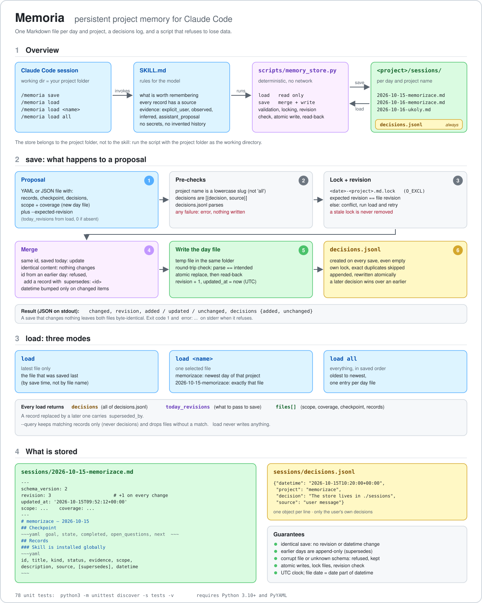

# Memoria

Persistent, project-local memory for [Claude Code](https://claude.com/claude-code), packaged as a skill.

Claude saves what matters from a session (records with sources, a checkpoint, and the user's own decisions) into plain Markdown files inside your project, and loads them back in the next session. A small deterministic script does all the file work; the model only prepares a proposal.



## Features

- **One file per day and project**, named `<date>-<project>.md`, e.g. `2026-10-15-memorizace.md`. Readable, greppable, diffable.
- **Lives in the project**: everything is stored in `<project>/sessions/`, so memory travels with the repository and every project has its own history.
- **`decisions.jsonl`**: a short log of the user's own decisions about the project, loaded with every `load`.
- **Three load modes**: the latest file, one selected file, or everything in saved order.
- **Traceable records**: every record carries a `source`, an `evidence` level (`explicit_user`, `observed`, `inferred`, `assistant_proposal`) and a `status`.
- **Safe writes**: validation, lock files, revision check, temp file with round-trip check, atomic replace, read-back. Identical saves change nothing, byte for byte.
- **Append-only history**: a record from an earlier day is never edited; a correction is a new record with `supersedes: <old id>`.

It does not run in the background and has no access to earlier chats; it remembers what a session saves.

## Install

```bash
git clone https://github.com/mkajnar/Memoria ~/.claude/skills/memoria
pip install pyyaml        # Python 3.10+ is required
```

Claude Code reads `SKILL.md` and offers the skill as `/memoria`.

## Usage

Run Claude Code from your project folder; the working directory decides where `sessions/` is.

| Command | What it does |
| --- | --- |
| `/memoria save` | Create or update memory from the session context |
| `/memoria load` | Load **only the latest** saved file |
| `/memoria load <name>` | Load **one selected file**: a project name (`memorizace` selects that project's newest day) or a file name (`2026-10-15-memorizace`) |
| `/memoria load all` | Load **every file**, oldest to newest, in the order they were saved |

Natural-language requests work as well: show, resume, correct a statement, forget something. See [`SKILL.md`](SKILL.md) for the rules the model follows.

## What is stored

```text
<project>/sessions/
├── 2026-10-15-memorizace.md
├── 2026-10-16-memorizace.md
├── 2026-10-16-ukoly.md
└── decisions.jsonl
```

- The date is the date part of the save's **UTC** `datetime` (no time). A save at 00:30 Prague time on the 16th lands in the file of the 15th.
- The project name is a lowercase ASCII slug (`a-z`, `0-9`, `-`, not `all`). Pass `--project`, otherwise the working directory's name is used.

### Day file

Written by the script; edit by hand only to forget something.

```markdown
---
schema_version: 2
revision: 1
updated_at: '2026-10-15T10:13:37+00:00'
scope: Memoria skill, storage layout
coverage: This conversation only
---

# memorizace — 2026-10-15

## Checkpoint

~~~yaml
goal: Ship a working memory skill
state: Script and tests are done
next: Publish the repository
~~~

## Records

### Memory lives in the project folder

~~~yaml
id: mem-9ec87ca7
title: Memory lives in the project folder
kind: decision
status: active
evidence: explicit_user
scope: storage
description: Memory is kept in ./sessions so it travels with the project and every project has its own
  history.
source: 'user: "store it in the sessions subfolder of the project"'
datetime: '2026-10-15T10:13:37+00:00'
~~~
```

`kind` is one of `preference`, `fact`, `decision`, `proposal`, `open_question`; `status` is `active`, `uncertain` or `superseded`. `datetime` is the time of the last save that changed the record, taken from the clock by the script.

### decisions.jsonl

One JSON object per line, created by every successful `save` (empty if there is nothing to log):

```json
{"datetime": "2026-10-15T10:13:37+00:00", "project": "memorizace", "decision": "The store lives in ./sessions", "source": "user message"}
```

Only decisions the user made themselves go here, one short sentence each. A later decision that reverses an earlier one is appended as a new line; the later line wins. Exact duplicates are skipped.

## The script

`scripts/memory_store.py` is what the skill runs. Call it from the project folder:

```bash
cd /path/to/project
S=~/.claude/skills/memoria/scripts/memory_store.py

python3 $S load                      # latest file
python3 $S load memorizace           # newest day of a project
python3 $S load 2026-10-15-memorizace
python3 $S load all                  # everything, oldest to newest
python3 $S load all --query "store"  # records whose title/description contain the text

python3 $S save --project memorizace --input proposal.yaml --expected-revision 0
```

`--store-dir` selects another store folder instead of `./sessions`.

### save

The proposal is a YAML or JSON file:

```yaml
scope: Memoria skill, storage layout
coverage: This conversation only
records:
  - kind: decision
    scope: storage
    source: 'user: "store it in the sessions subfolder of the project"'
    evidence: explicit_user
    status: active
    title: Memory lives in the project folder
    description: Memory is kept in ./sessions so it travels with the project.
checkpoint:
  goal: Ship a working memory skill
  state: Script and tests are done
  next: Publish the repository
decisions:
  - decision: The store lives in ./sessions
    source: user message
```

`--expected-revision` is `today_revisions[<project>]` from the latest `load`, or `0` when the project has no file today. The result:

```json
{
  "path": ".../sessions/2026-10-15-memorizace.md",
  "changed": true,
  "revision": 1,
  "added": ["mem-9ec87ca7"],
  "updated": [],
  "unchanged": [],
  "decisions": {"added": 1, "unchanged": 0}
}
```

| Situation | Result |
| --- | --- |
| Identical content saved again | Nothing changes: same bytes, same revision, same `datetime` |
| Same `id`, saved today, different content | Updated; only that record's `datetime` moves |
| Same content without an `id` (today or any earlier day of the project) | Skipped as a duplicate |
| `id` from an earlier day, different content | Refused: add a new record with `supersedes: <id>` |
| `supersedes` points to an unknown id | Refused |
| `scope` / `coverage` alone | No new file; records or a checkpoint create it |
| New day file without `scope` and `coverage` | Refused |
| Wrong `--expected-revision` | Conflict, nothing written; run `load` and retry |
| Stale `.lock` file | Refused, the lock is never removed automatically |
| Malformed decisions, corrupt `decisions.jsonl`, unknown `schema_version` | Refused, files left untouched |
| Day file above ~1,500 words | Saved, with a `warnings` entry |

Errors exit with code 1 and `error: ...` on stderr.

### load

`load` never writes. It prints JSON:

| Key | Content |
| --- | --- |
| `decisions` | All of `decisions.jsonl`, oldest to newest, in every mode (not affected by `--query`) |
| `today_revisions` | `{project: revision}` of today's files: what to pass to `save` |
| `files[]` | Per file: `file`, `date`, `project`, `revision`, `updated_at`, `scope`, `coverage`, `checkpoint`, `records` |

A record replaced by a later one carries `superseded_by`. "Latest" means saved last (by `updated_at`), not last by file name.

## Tests

```bash
python3 -m unittest discover -s tests -v
```

78 tests: naming, rendering and parsing (including hostile content such as code fences and `---` inside records), validation, every save rule above, the decisions log, all three load modes, the command line, and a check that `SKILL.md` still documents the options and layout the script offers. The clock is mocked, so nothing sleeps and midnight cannot make a test flaky.

## Notes

- `sessions/` holds project notes. If your project is a git repository, decide deliberately whether to commit it; add `sessions/` to `.gitignore` to keep it local. This repository's own `.gitignore` already does.
- The skill tells the model never to store passwords or tokens, but the script cannot verify that.

## Repository layout

```text
SKILL.md                      the skill: rules for the model
scripts/memory_store.py       load and save
tests/test_memory_store.py    unit tests
docs/memoria-schema.svg|png   the diagram above
```
